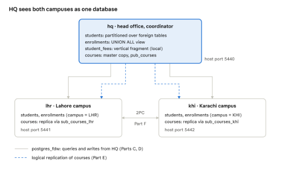

# Lab: Distributed Database on PostgreSQL 18

Advanced Database Management Systems · Nov 23, 2026 · @Asim Riaz

## Lab overview

In this lab you build a three-site university database, **UniDB**, on three PostgreSQL 18 servers running in Docker, then query, replicate and transact across them as if they were one database.

**Scenario.** A university has a head office (HQ) and two campuses, Lahore (LHR) and Karachi (KHI). Each campus stores its own students locally. HQ owns the course catalogue and the fee records, and gives management one global view of everything.

| Node (container) | Role | Stores | Host port |
| --- | --- | --- | --- |
| `hq` | Coordinator, global schema | `courses` (master copy), `student_fees`, foreign tables for the sites | 5440 |
| `lhr` | Lahore campus site | `students` and `enrollments` where campus = LHR, replica of `courses` | 5441 |
| `khi` | Karachi campus site | `students` and `enrollments` where campus = KHI, replica of `courses` | 5442 |




HQ stores no student rows: it reads and writes them at the campuses through postgres\_fdw, and pushes the course catalogue out to both.

**Learning outcomes.** By the end you can:

1. Design horizontal, derived horizontal and vertical fragments and check them for completeness, reconstruction and disjointness.
2. Build a global schema with `postgres_fdw` that gives location transparency.
3. Read distributed query plans: partition pruning, predicate and aggregate push-down, join push-down and asynchronous scans.
4. Fully replicate a reference table with logical replication and diagnose a replication conflict.
5. Run a distributed transaction with two-phase commit and show it survives a site crash.

**Prerequisites.** Docker Desktop or Docker Engine with Compose v2, about 1 GB free disk, and the lab kit folder (`compose.yaml` and the `sql/` scripts). Basic SQL and psql are assumed.

**Time.** About 3 hours: Parts A to D in the first session, E to G and the tasks in the second.

## Part A: Start three PostgreSQL 18 nodes

One `compose.yaml` starts all three sites on a private Docker network, where they reach each other by the names `hq`, `lhr` and `khi`.

```yaml
# compose.yaml — Distributed Database Lab, PostgreSQL 18 (3 nodes)
name: ddb-lab

x-pg-node: &pg-node
  image: postgres:18
  environment:
    POSTGRES_USER: postgres
    POSTGRES_PASSWORD: postgres
    POSTGRES_DB: unidb
  command:
    - postgres
    - -c
    - wal_level=logical             # needed for logical replication
    - -c
    - max_prepared_transactions=20  # needed for two-phase commit
  healthcheck:
    test: ["CMD-SHELL", "pg_isready -U postgres -d unidb"]
    interval: 5s
    retries: 10
  networks: [ddbnet]

services:
  hq:                      # coordinator / head office (global schema)
    <<: *pg-node
    container_name: hq
    hostname: hq
    ports: ["5440:5432"]
    volumes:
      - hq_data:/var/lib/postgresql      # PG18 image: mount here, not .../data
      - ./sql:/lab:ro

  lhr:                     # Lahore campus site
    <<: *pg-node
    container_name: lhr
    hostname: lhr
    ports: ["5441:5432"]
    volumes:
      - lhr_data:/var/lib/postgresql
      - ./sql:/lab:ro

  khi:                     # Karachi campus site
    <<: *pg-node
    container_name: khi
    hostname: khi
    ports: ["5442:5432"]
    volumes:
      - khi_data:/var/lib/postgresql
      - ./sql:/lab:ro

networks:
  ddbnet:

volumes:
  hq_data:
  lhr_data:
  khi_data:
```

Two settings matter for later parts. `wal_level=logical` lets HQ publish changes (Part E), and `max_prepared_transactions` above 0 enables `PREPARE TRANSACTION` (Part F); its default is 0.

> **PostgreSQL 18 image change.** From version 18 the official image keeps data in `/var/lib/postgresql/18/docker` and expects the volume at `/var/lib/postgresql`. Old tutorials mount `/var/lib/postgresql/data`; with `postgres:18` that mount fails or silently loses data. ([Docker Hub: postgres](https://hub.docker.com/_/postgres))

**Steps**

1. Put `compose.yaml` and the `sql/` folder in one directory and open a terminal there.
2. Start the nodes: `docker compose up -d`
3. Wait until all three show `healthy`: `docker compose ps`
4. Confirm the version on each node: `docker exec hq psql -U postgres -d unidb -c "SELECT version();"` (repeat for `lhr` and `khi`).
5. Open one terminal per node and keep them open for the whole lab:

```bash
docker exec -it hq  psql -U postgres -d unidb    # terminal 1
docker exec -it lhr psql -U postgres -d unidb    # terminal 2
docker exec -it khi psql -U postgres -d unidb    # terminal 3
```

**Checkpoint A.** Each terminal shows the `unidb=#` prompt and `SELECT version();` reports PostgreSQL 18.x.

## Part B: Create the fragments at each site

The global relation STUDENT is split by campus, so each site stores only the rows it uses most: this is **horizontal fragmentation**, defined by a selection predicate.

- STUDENT\_LHR = σ campus = 'LHR' (STUDENT)
- STUDENT\_KHI = σ campus = 'KHI' (STUDENT)

ENROLLMENT has no campus column, so it is fragmented to follow its owner: ENROLLMENT\_LHR = ENROLLMENT ⋉ STUDENT\_LHR. This is **derived horizontal fragmentation**; it keeps a student and their enrollments on the same site so joins stay local.

The `CHECK (campus = 'LHR')` constraint is the fragment's predicate written into the schema. It stops a wrong row landing at the wrong site, and you will see it fire in Part D.

**Run on `lhr`** (file `sql/01_site_lhr.sql`):

```sql
CREATE TABLE students (
    student_id  int          PRIMARY KEY,
    name        text         NOT NULL,
    campus      char(3)      NOT NULL CHECK (campus = 'LHR'),
    program     text         NOT NULL,
    cgpa        numeric(3,2) CHECK (cgpa BETWEEN 0 AND 4)
);

CREATE TABLE enrollments (
    student_id  int  NOT NULL REFERENCES students(student_id),
    course_code text NOT NULL,
    semester    text NOT NULL,
    grade       text,
    PRIMARY KEY (student_id, course_code, semester)
);

INSERT INTO students VALUES
 (1001,'Ayesha Khan','LHR','BSCS',3.62),
 (1002,'Bilal Ahmed','LHR','BSCS',3.10),
 (1003,'Hamza Tariq','LHR','BSSE',2.85),
 (1004,'Fatima Noor','LHR','BSCS',3.91),
 (1005,'Usman Ali'  ,'LHR','BSAI',3.25),
 (1006,'Zainab Raza','LHR','BSSE',2.40);

INSERT INTO enrollments VALUES
 (1001,'CS-501','Fall-2026','A'),  (1001,'CS-502','Fall-2026','B+'),
 (1002,'CS-501','Fall-2026','B'),  (1003,'CS-503','Fall-2026','C+'),
 (1003,'CS-501','Fall-2026','B-'), (1004,'CS-502','Fall-2026','A'),
 (1005,'CS-504','Fall-2026','A-'), (1006,'CS-503','Fall-2026','C');
```

Or from inside psql: `\i /lab/01_site_lhr.sql`

**Run on `khi`** (file `sql/01_site_khi.sql`): the same two tables with `CHECK (campus = 'KHI')`, and these rows:

```sql
INSERT INTO students VALUES
 (2001,'Sana Iqbal'    ,'KHI','BSCS',3.45),
 (2002,'Ahmed Siddiqui','KHI','BSAI',3.78),
 (2003,'Maria Shah'    ,'KHI','BSCS',2.95),
 (2004,'Omar Farooq'   ,'KHI','BSSE',3.05),
 (2005,'Hira Baig'     ,'KHI','BSCS',3.55);

INSERT INTO enrollments VALUES
 (2001,'CS-501','Fall-2026','B+'), (2002,'CS-504','Fall-2026','A'),
 (2002,'CS-502','Fall-2026','A-'), (2003,'CS-501','Fall-2026','C+'),
 (2004,'CS-503','Fall-2026','B'),  (2005,'CS-502','Fall-2026','B+');
```

**Checkpoint B.** `SELECT count(*) FROM students;` returns 6 on `lhr` and 5 on `khi`. Student IDs use separate ranges per campus (1xxx, 2xxx) because no single site can enforce a global primary key.

## Part C: Build the global schema at HQ

HQ stores no student rows; it reaches the sites through **postgres\_fdw**, so users at HQ query one table called `students` without knowing where its rows live (location transparency).

**Run on `hq`** (file `sql/02_hq_global_schema.sql`), one step at a time:

```sql
CREATE EXTENSION IF NOT EXISTS postgres_fdw;

-- C1. One foreign server per site; async_capable lets HQ scan sites in parallel
CREATE SERVER lhr_srv FOREIGN DATA WRAPPER postgres_fdw
    OPTIONS (host 'lhr', port '5432', dbname 'unidb', async_capable 'true');
CREATE SERVER khi_srv FOREIGN DATA WRAPPER postgres_fdw
    OPTIONS (host 'khi', port '5432', dbname 'unidb', async_capable 'true');

-- C2. How the local user logs in at each site
CREATE USER MAPPING FOR postgres SERVER lhr_srv OPTIONS (user 'postgres', password 'postgres');
CREATE USER MAPPING FOR postgres SERVER khi_srv OPTIONS (user 'postgres', password 'postgres');

-- C3. Raw access to each site, one schema per site
CREATE SCHEMA lhr;
CREATE SCHEMA khi;
IMPORT FOREIGN SCHEMA public LIMIT TO (students, enrollments) FROM SERVER lhr_srv INTO lhr;
IMPORT FOREIGN SCHEMA public LIMIT TO (students, enrollments) FROM SERVER khi_srv INTO khi;
```

Note the host is the container name and the port is `5432`, the port inside the Docker network, not the host port 5441.

**C4. Global STUDENT = union of horizontal fragments.** A partitioned table whose partitions are foreign tables. The partition bounds play the role of the fragmentation predicates:

```sql
CREATE TABLE students (
    student_id  int          NOT NULL,
    name        text         NOT NULL,
    campus      char(3)      NOT NULL,
    program     text         NOT NULL,
    cgpa        numeric(3,2)
) PARTITION BY LIST (campus);

CREATE FOREIGN TABLE students_lhr PARTITION OF students FOR VALUES IN ('LHR')
    SERVER lhr_srv OPTIONS (table_name 'students');
CREATE FOREIGN TABLE students_khi PARTITION OF students FOR VALUES IN ('KHI')
    SERVER khi_srv OPTIONS (table_name 'students');
```

**C5. Global ENROLLMENT = union of derived fragments,** this time as a plain view so you can compare the two methods:

```sql
CREATE VIEW enrollments AS
    SELECT 'LHR'::char(3) AS campus, * FROM lhr.enrollments
    UNION ALL
    SELECT 'KHI'::char(3) AS campus, * FROM khi.enrollments;
```

**C6. Vertical fragment at HQ.** The finance office keeps the fee columns of STUDENT locally. The fragment repeats the key `student_id`, so STUDENT can be rebuilt with a join:

```sql
CREATE TABLE student_fees (
    student_id  int PRIMARY KEY,
    fee_due     numeric(10,2) NOT NULL,
    fee_paid    numeric(10,2) NOT NULL DEFAULT 0
);
INSERT INTO student_fees VALUES
 (1001,180000,180000),(1002,180000,90000),(1003,165000,165000),
 (1004,180000,180000),(1005,195000,100000),(1006,165000,0),
 (2001,180000,180000),(2002,195000,195000),(2003,180000,60000),
 (2004,165000,165000),(2005,180000,120000);
```

**Try it on `hq`:**

```sql
-- All 11 students, from two sites, in one query
SELECT * FROM students ORDER BY student_id;

-- Which fragment did each row come from?
SELECT tableoid::regclass AS fragment, count(*) FROM students GROUP BY 1;

-- Reconstruct the vertical fragment: students with fees outstanding
SELECT s.student_id, s.name, s.campus, f.fee_due - f.fee_paid AS balance
FROM students s JOIN student_fees f USING (student_id)
WHERE f.fee_paid < f.fee_due
ORDER BY balance DESC;

-- Writes are routed to the right site automatically
INSERT INTO students VALUES (1007,'Ali Hassan','LHR','BSCS',3.33),
                            (2006,'Noor Fatima','KHI','BSAI',3.70);
```

Now run `SELECT * FROM students;` on `lhr` and `khi`: each new row is stored only at its own site.

**Checkpoint C.** The fragment query shows `students_lhr | 6` and `students_khi | 5` (before the insert). The fee query returns 5 students, Zainab Raza first with a balance of 165000.00.

**Limitation to notice.** You cannot add a `PRIMARY KEY` to the global `students` table: PostgreSQL cannot build a unique index across foreign partitions. Global uniqueness must come from the design, such as campus ID ranges or globally unique keys like PostgreSQL 18's new `uuidv7()`.

## Part D: Read distributed query plans

A good distributed plan ships the query to the data, not the data to the query. `EXPLAIN (VERBOSE)` shows the exact **Remote SQL** HQ sends to each site, so you can see how much work is pushed down. Run each query on `hq`.

**D1. Partition pruning (fragment elimination).**

```sql
EXPLAIN (VERBOSE, COSTS OFF)
SELECT name, cgpa FROM students WHERE campus = 'KHI' AND cgpa > 3.5;
```

Only `students_khi` appears in the plan. Lahore is never contacted, and the `cgpa > 3.5` filter runs at Karachi:

```text
 Foreign Scan on public.students_khi students
   Output: students.name, students.cgpa
   Remote SQL: SELECT name, cgpa FROM public.students WHERE ((cgpa > 3.5)) AND ((campus = 'KHI'))
```

**D2. Parallel scans across sites.** Drop the campus filter and both sites are scanned. `Async Foreign Scan` means HQ sends both requests at once instead of waiting for Lahore before asking Karachi (the `async_capable` option from C1):

```sql
EXPLAIN (VERBOSE, COSTS OFF) SELECT * FROM students WHERE cgpa > 3.5;
```

**D3. Aggregate push-down.** Each site can compute its own count and average and send back one row:

```sql
SET enable_partitionwise_aggregate = on;
EXPLAIN (VERBOSE, COSTS OFF)
SELECT campus, count(*), round(avg(cgpa),2) FROM students GROUP BY campus;
```

Look for `Relations: Aggregate on (public.students_lhr ...)` and a Remote SQL that contains `GROUP BY`. Repeat with the setting `off` and compare: the sites then ship every row to HQ.

**D4. Join push-down.** A join between two foreign tables on the same server runs entirely at that site:

```sql
EXPLAIN (VERBOSE, COSTS OFF)
SELECT s.name, e.course_code, e.grade
FROM lhr.students s JOIN lhr.enrollments e USING (student_id)
WHERE e.grade LIKE 'A%';
```

The plan shows one `Foreign Scan` with `Relations: (lhr.students s) INNER JOIN (lhr.enrollments e)`. This is the pay-off of derived fragmentation: the join is local.

**D5. A join that cannot be pushed down.** `student_fees` lives at HQ, so this join must happen at HQ:

```sql
EXPLAIN (VERBOSE, COSTS OFF)
SELECT s.name, f.fee_due - f.fee_paid AS balance
FROM students s JOIN student_fees f USING (student_id)
WHERE s.campus = 'LHR';
```

You get a local `Hash Join`, but only `student_id` and `name` travel from Lahore. That is **projection push-down**.

**D6. The fragment predicate protects you.** Try to move a student by changing the campus through the global table:

```sql
UPDATE students SET campus = 'KHI' WHERE student_id = 1007;
```

It fails with `violates check constraint "students_campus_check"`. The UPDATE was pushed to Lahore unchanged; without the CHECK, a KHI row would now sit inside the LHR fragment and the global view would be wrong. Moving a row between sites needs a delete at one site and an insert at another, in one atomic step. That is Part F.

**Checkpoint D.** You can point to the Remote SQL in each plan and say what was pushed down: filter, projection, aggregate or join.

## Part E: Replicate the course catalogue

Every site reads the course list constantly but it rarely changes, so it is **fully replicated**: HQ holds the master copy and pushes every change to both campuses with logical replication (publish/subscribe).

**E1. Publisher, on `hq`** (file `sql/03_hq_courses_publisher.sql`):

```sql
CREATE TABLE courses (
    course_code  text PRIMARY KEY,
    title        text NOT NULL,
    credit_hours int  NOT NULL
);
INSERT INTO courses VALUES
 ('CS-501','Advanced Database Management Systems',3),
 ('CS-502','Distributed Systems',3),
 ('CS-503','Software Construction',3),
 ('CS-504','Machine Learning',3);

CREATE PUBLICATION pub_courses FOR TABLE courses;
```

**E2. Subscribers, on `lhr` and on `khi`.** Logical replication copies rows, not table definitions, so create the empty table first. Each subscription needs its own name, because each one creates a replication slot on HQ.

```sql
-- on lhr (on khi, name it sub_courses_khi)
CREATE TABLE courses (
    course_code  text PRIMARY KEY,
    title        text NOT NULL,
    credit_hours int  NOT NULL
);

CREATE SUBSCRIPTION sub_courses_lhr
    CONNECTION 'host=hq port=5432 dbname=unidb user=postgres password=postgres'
    PUBLICATION pub_courses;
```

You should see `NOTICE: created replication slot "sub_courses_lhr" on publisher`. Run `SELECT * FROM courses;` at each site: the four existing rows were copied in the initial sync.

**E3. Watch a change flow.** On `hq`:

```sql
INSERT INTO courses VALUES ('CS-505','Cloud Computing',3);
SELECT slot_name, active FROM pg_replication_slots;   -- two active slots
```

Within a second, `CS-505` appears at both sites. Now a distributed query can join enrollments to course titles locally at each site.

**E4. Cause a conflict.** Replicas should be read-only, but nothing stops a local write. On `lhr` only:

```sql
INSERT INTO courses VALUES ('CS-506','Local Course',2);
```

Then on `hq`:

```sql
INSERT INTO courses VALUES ('CS-506','Information Security',3);
```

Karachi receives the new course; Lahore does not. On `lhr`, check the statistics view (PostgreSQL 18 adds one counter per conflict type):

```sql
SELECT subname, apply_error_count, confl_insert_exists
FROM pg_stat_subscription_stats;
```

The Lahore container log, `docker logs lhr --tail 20`, shows the conflict repeating as the apply worker retries. Replication to Lahore is now **stuck**: every later change from HQ waits behind this row.

**E5. Resolve it.** Remove the local row on `lhr` and the worker catches up by itself within a few seconds:

```sql
DELETE FROM courses WHERE course_code = 'CS-506';
-- wait ~5 s
SELECT * FROM courses WHERE course_code = 'CS-506';   -- Information Security
```

Two more PostgreSQL 18 changes worth knowing: new subscriptions now default to `streaming = parallel`, and an inactive slot can be dropped automatically with `idle_replication_slot_timeout`. ([PostgreSQL 18 release notes](https://www.postgresql.org/docs/release/18/))

**Checkpoint E.** All three nodes list the same 6 courses, and `confl_insert_exists` on `lhr` is greater than 0.

## Part F: Transfer a student with two-phase commit

Moving Hamza Tariq (1003) from Lahore to Karachi touches two sites, and it must happen at both or at neither. **Two-phase commit (2PC)** gives that guarantee: in phase 1 every site prepares and promises it can commit; in phase 2 the coordinator tells all of them to commit.

Why not just one transaction at HQ? postgres\_fdw commits the remote transactions one after another when HQ commits. If a site fails between those commits, one site has committed and the other has not. PostgreSQL leaves the 2PC protocol to you, so in this part **you are the coordinator**.

**F1. Phase 1 on `lhr`: prepare the delete.**

```sql
BEGIN;
DELETE FROM enrollments WHERE student_id = 1003;
DELETE FROM students    WHERE student_id = 1003;
PREPARE TRANSACTION 'xfer_1003';
```

**F2. Phase 1 on `khi`: prepare the insert.**

```sql
BEGIN;
INSERT INTO students VALUES (1003,'Hamza Tariq','KHI','BSSE',2.85);
INSERT INTO enrollments VALUES (1003,'CS-503','Fall-2026','C+'),
                               (1003,'CS-501','Fall-2026','B-');
PREPARE TRANSACTION 'xfer_1003';
```

After `PREPARE TRANSACTION` the session is free; the transaction now belongs to the server, not to your psql connection. List it on either site:

```sql
SELECT gid, prepared, owner, database FROM pg_prepared_xacts;
```

**F3. Look from HQ while the transfer is in doubt.**

```sql
SELECT tableoid::regclass, student_id, campus FROM students WHERE student_id = 1003;
```

It still shows `students_lhr | 1003 | LHR`. Prepared changes are invisible until phase 2.

**F4. Crash a participant.** In a host terminal, kill Karachi without a clean shutdown, then start it again:

```bash
docker kill khi
docker start khi
docker exec -it khi psql -U postgres -d unidb
```

```sql
SELECT gid FROM pg_prepared_xacts;   -- xfer_1003 is still there
```

A prepared transaction is written to disk, so it survives a crash. Karachi still remembers its promise and waits for the coordinator's decision.

**F5. Phase 2: commit everywhere.** Run on `khi`, then on `lhr`:

```sql
COMMIT PREPARED 'xfer_1003';
```

Back on `hq`:

```sql
SELECT tableoid::regclass, student_id, campus FROM students WHERE student_id = 1003;
SELECT * FROM enrollments WHERE student_id = 1003;
```

Now the row comes from `students_khi` and both enrollments show campus KHI.

**F6. The abort path.** Repeat F1 and F2 for student 1002 moving to Karachi, but finish with `ROLLBACK PREPARED 'xfer_1002';` on both sites. Confirm 1002 is still in Lahore with its enrollment.

**Watch out.** A prepared transaction that is never finished keeps its locks and stops VACUUM from cleaning up. Always end a lab session with `SELECT * FROM pg_prepared_xacts;` returning no rows on every site.

**Checkpoint F.** HQ shows 7 students at KHI and 6 at LHR (after the Part C insert and this transfer), and `pg_prepared_xacts` is empty everywhere.

## Part G: Lose a site

A distributed database should keep working for queries that do not need the failed site. Stop Karachi and see which queries still run.

```bash
docker stop khi
```

On `hq`:

```sql
SELECT count(*) FROM students;                      -- fails
SELECT count(*) FROM students WHERE campus = 'LHR'; -- works: 6
SELECT * FROM courses;                              -- works: local master copy
```

The first query fails with `could not connect to server "khi_srv"`. The second succeeds because pruning removed Karachi from the plan before any connection was made. Lahore can also keep reading its own replica of `courses`.

While Karachi is down, insert a course on `hq`, then bring Karachi back:

```sql
INSERT INTO courses VALUES ('CS-507','Data Mining',3);
```

```bash
docker start khi
```

Karachi's replication slot on HQ held the change, so `CS-507` arrives as soon as Karachi reconnects. Check with `SELECT * FROM courses;` on `khi`.

See which site connections HQ holds and whether each is still usable. Run this in the same `hq` session after a global query (PostgreSQL 18 adds the `user_name`, `used_in_xact`, `closed` and `remote_backend_pid` columns):

```sql
SELECT * FROM postgres_fdw_get_connections(true);
```

**Checkpoint G.** You can explain why one query failed and the other did not, and `CS-507` is present on all three nodes.

## Lab tasks

Submit the SQL you wrote and a screenshot of each result. Tasks 1 to 4 are compulsory; task 5 is for bonus marks.

1. **Correctness of fragmentation.** Write three queries on `hq` that prove the STUDENT fragmentation is complete (every student is in some fragment), reconstructable (the union gives the global relation) and disjoint (no `student_id` is in both fragments).
2. **Add a third campus.** Add an Islamabad site `isb` to `compose.yaml` (host port 5443) with its own `students` and `enrollments` fragments and three students. Attach it at HQ as a new foreign partition and subscribe it to `pub_courses`. Show `SELECT campus, count(*) FROM students GROUP BY campus;` returning three rows.
3. **Vertical fragmentation report.** Write one query on `hq` listing, per campus, the number of students with fees outstanding and the total balance. Show its `EXPLAIN (VERBOSE)` and mark which work runs at each site.
4. **Distributed transfer.** Move student 2004 from Karachi to Islamabad with 2PC, including the enrollment. Before phase 2, crash `isb` with `docker kill`, restart it, and finish the commit.
5. **Bonus: globally unique keys.** Re-create the `students` fragments at one site using `student_id uuid DEFAULT uuidv7()`. Explain in three sentences why time-ordered UUIDs suit a distributed insert workload better than per-site integer ranges.

## Viva questions

1. Why is `enrollments` fragmented by its owner and not by its own attributes?
2. What does `async_capable` change in the plan, and when does it not help?
3. Why can HQ not declare a primary key on the global `students` table?
4. Where would you place `courses` if it were updated every minute instead of every semester?
5. What happens to a prepared transaction if the coordinator crashes and never returns?
6. Which replication conflict did Part E cause, and how else could it be avoided?

## Clean up

First make sure no prepared transactions are left (`SELECT * FROM pg_prepared_xacts;` on each node). Then:

```bash
docker compose down        # stop and remove containers, keep data
docker compose down -v     # also delete the three data volumes
```

## Sources

- [PostgreSQL 18 release notes](https://www.postgresql.org/docs/release/18/)
- [PostgreSQL 18 documentation: postgres\_fdw](https://www.postgresql.org/docs/18/postgres-fdw.html)
- [PostgreSQL 18 documentation: monitoring statistics (pg\_stat\_subscription\_stats)](https://www.postgresql.org/docs/18/monitoring-stats.html)
- [Docker Hub: postgres official image (PGDATA change in 18)](https://hub.docker.com/_/postgres)
