# MongoDB Lab Setup: Docker, Compass Web, mongosh and Mongoose

In this lab you will run a MongoDB server inside Docker on a **Debian VM**, browse it with **Compass Web** from Chrome, load a `courses` collection, query it with **mongosh**, and finally read the same data from a **Node.js + Mongoose** script on your **Windows 11** host.

---

## Contents

- [What you need](#what-you-need)
- [Part A: Prepare the Debian VM](#part-a-prepare-the-debian-vm)
  - [Step 1: Find the VM's IP address](#step-1-find-the-vms-ip-address)
  - [Step 2: Point Docker at the lab's Docker Hub cache](#step-2-point-docker-at-the-labs-docker-hub-cache)
  - [Step 3: Download the lab files](#step-3-download-the-lab-files)
  - [Step 4: Start MongoDB and Compass Web](#step-4-start-mongodb-and-compass-web)
- [Part B: Browse MongoDB with Compass Web](#part-b-browse-mongodb-with-compass-web)
  - [Step 5: Open Compass Web in Chrome and connect](#step-5-open-compass-web-in-chrome-and-connect)
- [Part C: Load and query data with mongosh](#part-c-load-and-query-data-with-mongosh)
  - [Step 6: Import the courses collection](#step-6-import-the-courses-collection)
  - [Step 7: Open mongosh](#step-7-open-mongosh)
  - [Step 8: List databases](#step-8-list-databases)
  - [Step 9: Switch to the academic database](#step-9-switch-to-the-academic-database)
  - [Step 10: List collections](#step-10-list-collections)
  - [Step 11: Read the documents](#step-11-read-the-documents)
- [Part D: Query MongoDB from Node.js with Mongoose (Windows 11)](#part-d-query-mongodb-from-nodejs-with-mongoose-windows-11)
  - [Step 12: Create a project folder](#step-12-create-a-project-folder)
  - [Step 13: Check Node.js](#step-13-check-nodejs)
  - [Step 14: Initialise the project and install Mongoose](#step-14-initialise-the-project-and-install-mongoose)
  - [Step 15: Download the model generator](#step-15-download-the-model-generator)
  - [Step 16: Point the generator at your VM](#step-16-point-the-generator-at-your-vm)
  - [Step 17: Generate models.js](#step-17-generate-modelsjs)
  - [Step 18: Create REPL.js](#step-18-create-repljs)
  - [Step 19: Run REPL.js](#step-19-run-repljs)
  - [Step 20: Check your project folder](#step-20-check-your-project-folder)
- [Troubleshooting](#troubleshooting)
- [Changes from the original step list](#changes-from-the-original-step-list)

---

## What you need

| Machine | Requirements |
|---|---|
| Debian VM | Docker Engine with the Compose plugin, `sudo` access, `wget`, network interface `ens33` (adjust the name if yours differs) |
| Windows 11 host | Google Chrome, Node.js (LTS) with npm, network access to the VM |

Throughout this tutorial, `<Debian VM IP>` means the IPv4 address you find in Step 1, for example `192.168.10.128`.

---

## Part A: Prepare the Debian VM

### Step 1: Find the VM's IP address

Show every network interface and its addresses:

```bash
ip a
```

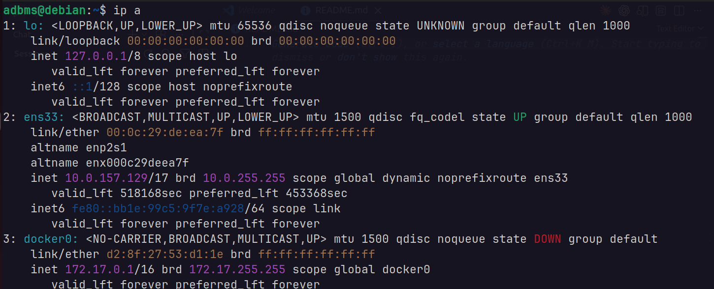

Look for the `inet` line under `ens33`. The address before the `/` (for example `192.168.10.128/24`) is your VM's IP.

These variations show the same interface in different ways:

```bash
ip -br a show ens33      # one-line summary: name, state, IPs
ip link show ens33       # link-layer only (MAC, MTU, state), no IPs
ip -4 a show ens33       # IPv4 addresses only
ip -s link show ens33    # with packet/byte/error counters
```

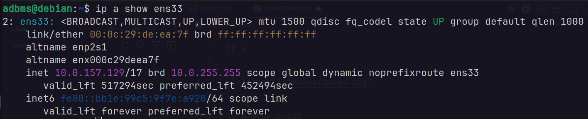

> **Tip:** `ip -br a show ens33` is the quickest way to read the IP. Write it down; you will use it in Steps 5 and 16.

---

### Step 2: Point Docker at the lab's Docker Hub cache

The lab has a local Docker Hub cache (registry mirror) at `10.0.149.224:5001`. Configuring Docker to use it means images are pulled from the lab network instead of the internet, which is much faster.

```bash
echo '{
    "dns": [ "8.8.8.8", "1.1.1.1" ],
    "insecure-registries": [ "10.0.149.224:5001" ],
    "registry-mirrors": [ "http://10.0.149.224:5001" ]
}' | sudo tee /etc/docker/daemon.json && sudo systemctl restart docker
```

What each setting does:

| Key | Purpose |
|---|---|
| `dns` | DNS servers that containers use |
| `insecure-registries` | Allows Docker to talk to the cache over plain HTTP |
| `registry-mirrors` | Tells Docker to try the cache first when pulling Docker Hub images |

Confirm the mirror is active:

```bash
docker info | grep -A1 "Registry Mirrors"
```

> **Note:** This command **overwrites** `/etc/docker/daemon.json`. If you already have settings in that file, merge them by hand instead.

---

### Step 3: Download the lab files

Create a working folder and download the Compose file and the sample data:

```bash
cd ~
mkdir mongodb && cd mongodb
wget https://raw.githubusercontent.com/asimriaz/Advance-DBMS-Fall-2026/refs/heads/NoSQL/compose.yml
wget https://raw.githubusercontent.com/asimriaz/Advance-DBMS-Fall-2026/refs/heads/NoSQL/JSON/courses.json
```

Your folder should now look like this:

```
mongodb
├── compose.yml
└── courses.json
```

`compose.yml` defines two containers:

| Container | Image | Role |
|---|---|---|
| `mongo-db` | `mongo:8.0` | The MongoDB server. Publishes port **27017** (MongoDB) and **8080** (Compass Web). Data is kept in the `mongodb_data` volume. |
| `compass` | `haohanyang/compass-web` | A browser version of MongoDB Compass. It shares the `mongo-db` network, so it reaches MongoDB at `localhost:27017` and is served on port 8080. |

`courses.json` is a JSON array of course documents, each with `courseid`, `code`, `title`, `crhr` (credit hours) and `semester`.

---

### Step 4: Start MongoDB and Compass Web

From inside `~/mongodb`, start both containers in the background (`-d` = detached):

```bash
docker compose up -d
```

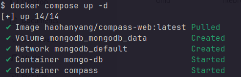

Check that both containers are running:

```bash
docker compose ps
```

You should see `mongo-db` and `compass` with status `Up` (or `running`).

---

## Part B: Browse MongoDB with Compass Web

### Step 5: Open Compass Web in Chrome and connect

Open **Google Chrome** and go to:

```
http://<Debian VM IP>:8080
```

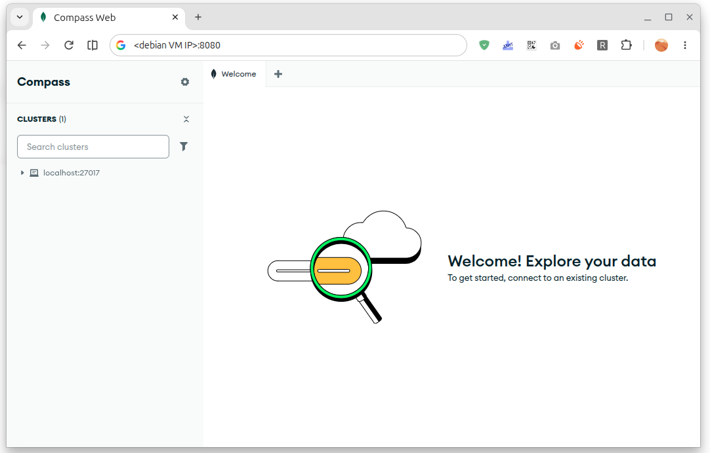

Click the **CONNECT** button to connect to the MongoDB server.

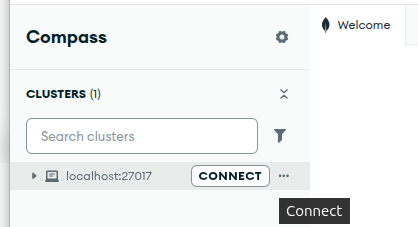

After connecting you will see the server's databases. At this point only the built-in ones (`admin`, `config`, `local`) exist; the `academic` database appears after Step 6.

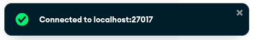

---

## Part C: Load and query data with mongosh

Run these steps on the Debian VM, inside `~/mongodb`.

### Step 6: Import the courses collection

```bash
docker exec -i mongo-db mongoimport --jsonArray -d academic -c courses < courses.json
```

How this works:

| Part | Meaning |
|---|---|
| `docker exec -i mongo-db` | Run a command inside the `mongo-db` container, with input from your terminal (`-i`) |
| `mongoimport` | MongoDB's import tool |
| `--jsonArray` | The file is a single JSON array of documents |
| `-d academic` | Target database `academic` (created automatically) |
| `-c courses` | Target collection `courses` (created automatically) |
| `< courses.json` | Feed the file from the VM into the container |

The last line of output reports how many documents were imported, for example `N document(s) imported successfully. 0 document(s) failed to import.`

> **Tip:** Refresh Compass Web; the `academic` database with its `courses` collection now appears.

> **Note:** Running the import twice inserts the documents twice. To start fresh, add `--drop`, which drops the collection before importing.

---

### Step 7: Open mongosh

Start the MongoDB Shell inside the container:

```bash
docker exec -it mongo-db mongosh
```

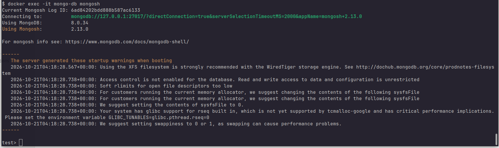

The prompt changes to `test>`, meaning you are connected and the current database is `test`.

---

### Step 8: List databases

```javascript
show databases
```

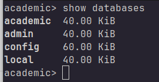

`academic` is listed alongside `admin`, `config` and `local`. (`show dbs` is a shorter form of the same command.)

---

### Step 9: Switch to the academic database

```javascript
use academic
```

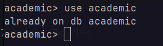

The prompt changes to `academic>`.

---

### Step 10: List collections

```javascript
show collections
```

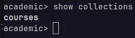

You should see `courses`.

---

### Step 11: Read the documents

```javascript
db.courses.find()
```

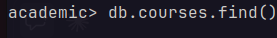

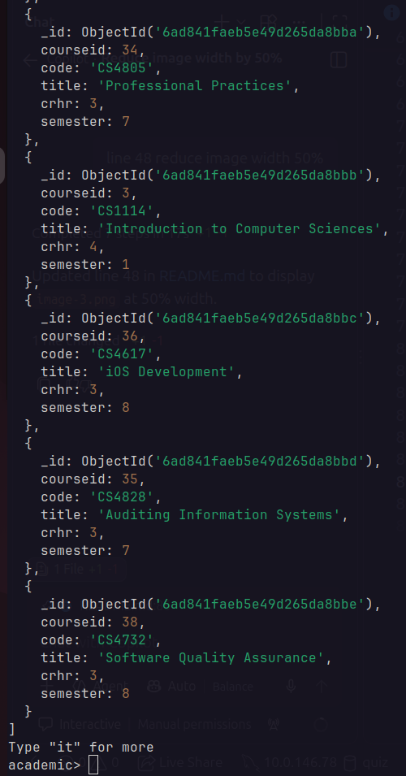

mongosh shows the first 20 documents. Type `it` to see the next batch. Each document has an `_id` (an `ObjectId` added by MongoDB) plus the fields from `courses.json`.

A few extra queries to try:

```javascript
db.courses.countDocuments()                      // how many courses
db.courses.find({ semester: 1 })                 // first-semester courses
db.courses.find({}, { code: 1, title: 1, _id: 0 }) // only code and title
```

Type `exit` to leave mongosh.

---

## Part D: Query MongoDB from Node.js with Mongoose (Windows 11)

Run these steps on your **Windows 11** host. Use **PowerShell** or **Command Prompt**.

### Step 12: Create a project folder

In File Explorer, open **Documents**, create a folder named **MongoDB**, then open a terminal in it. From a terminal you can do the same with:

```powershell
cd $HOME\Documents
mkdir MongoDB
cd MongoDB
```

---

### Step 13: Check Node.js

```powershell
node -v
```

This prints the installed version, for example `v22.x.x`. If you get *"node is not recognized"*, install the LTS version from nodejs.org, then open a new terminal.

---

### Step 14: Initialise the project and install Mongoose

```powershell
npm init -y
npm pkg set type=module
npm install mongoose
```

| Command | What it does |
|---|---|
| `npm init -y` | Creates `package.json` with default values |
| `npm pkg set type=module` | Marks the project as an ES module project, so `import ... from` and top-level `await` work |
| `npm install mongoose` | Installs Mongoose into `node_modules` and records it in `package.json` |

---

### Step 15: Download the model generator

```powershell
curl.exe -O https://raw.githubusercontent.com/asimriaz/Advance-DBMS-Fall-2026/refs/heads/NoSQL/generate-models.js
```

> **Note:** In Windows PowerShell, `curl` on its own is an alias for `Invoke-WebRequest`, which does not understand `-O`. Typing `curl.exe` runs the real curl that ships with Windows 11. In Command Prompt, plain `curl -O ...` works.

`generate-models.js` connects to a MongoDB database, reads the list of its collections and writes a Mongoose model for each one. Models are schema-less (`strict: false`), so every field in your documents is available. Collection names are turned into singular model names, so `courses` becomes `Course`.

---

### Step 16: Point the generator at your VM

Open `generate-models.js` in an editor (for example VS Code or Notepad) and find **line 18**:

```javascript
const MONGO_URI = process.env.MONGO_URI || "mongodb://localhost:27017/recapsheet";
```

Change it to use your VM's IP and the `academic` database:

```javascript
const MONGO_URI = process.env.MONGO_URI || "mongodb://<Debian VM IP>:27017/academic";
```

For example: `"mongodb://192.168.10.128:27017/academic"`. Save the file.

---

### Step 17: Generate models.js

```powershell
node generate-models.js models.js
```

The script prints the generated code and ends with `Written to models.js`. The new `models.js` looks like this (your IP will differ):

```javascript
import mongoose from "mongoose";
const { Schema } = mongoose;

if (mongoose.connection.readyState !== 1) {
      await mongoose.connect("mongodb://192.168.10.128:27017/academic");
}

const Course = mongoose.model("Course", new Schema({}, { strict: false }), "courses");

export const db = { Course };
```

If you see `No collections found in academic.`, go back to Step 6 and import the data.

---

### Step 18: Create REPL.js

In the same folder, create a file named `REPL.js` with this content:

```javascript
import util from "node:util";
import { db } from "./models.js";

db.Course.find()
.then(docs => console.log(
  `[\n${docs.map((doc) => `  ${util.inspect(doc, { colors: true, breakLength: Infinity })}`)
  .join(",\n")}\n]`))
.then(() => process.exit())
```

What it does:

1. Imports the `db` object from `models.js`, which also opens the connection to MongoDB.
2. Runs `db.Course.find()` to fetch every document in the `courses` collection.
3. Prints the documents as a coloured, fully expanded array using `util.inspect`.
4. Exits so the script does not hang on the open connection.

---

### Step 19: Run REPL.js

```powershell
node REPL.js
```

You should see the same course documents you saw in mongosh in Step 11.

---

### Step 20: Check your project folder

Your `MongoDB` folder should now contain:

```
.
├── generate-models.js
├── models.js
├── node_modules
├── package.json
├── package-lock.json
└── REPL.js
```

You can now change the query in `REPL.js` to try others, for example `db.Course.find({ semester: 1 })` or `db.Course.countDocuments()`.

---

## Troubleshooting

| Problem | Likely cause and fix |
|---|---|
| `docker compose up -d` is slow or fails to pull images | The mirror is not active. Re-run Step 2 and check `docker info`. |
| Chrome cannot open `http://<Debian VM IP>:8080` | Containers are not running (`docker compose ps`), or the IP is wrong (re-check Step 1). |
| `mongoimport`: *no such file or directory* | You are not in `~/mongodb`; run `cd ~/mongodb` first. |
| `SyntaxError: Cannot use import statement outside a module` | `package.json` is missing `"type": "module"`; run `npm pkg set type=module`. |
| `MongooseServerSelectionError` / `ECONNREFUSED` from Node | The Windows host cannot reach the VM on port 27017. Check the IP in `generate-models.js` (or `models.js`), and that the VM's network mode lets the host reach it. |
| `No collections found in academic.` | The data was not imported, or the URI still says `recapsheet`. Re-check Steps 6 and 16. |
| `models.js` still points to the old address | It is generated once; edit the URI in Step 16 and run Step 17 again. |

To stop the lab on the VM, run `docker compose down` inside `~/mongodb`. Your data stays in the `mongodb_data` volume; `docker compose down -v` deletes it too.

---

## Changes from the original step list

- **Step 4:** `docker compose up -s` changed to `docker compose up -d`; `-s` is not a valid option, and `-d` runs the containers in the background.
- **Steps 19 and 20:** the step list had two "Step 19" headings. The folder-structure step is now **Step 20**.
- **Step 14:** added `npm pkg set type=module`. Both `generate-models.js` and `REPL.js` use `import` syntax and top-level `await`, and recent npm versions write `"type": "commonjs"` into a new `package.json`, which makes those files fail to run.
- **Step 15:** `curl -O` changed to `curl.exe -O`, because plain `curl` in Windows PowerShell does not accept `-O`.
- **Step 12:** reworded ("on moved into that folder" → "then open a terminal in it") and added terminal commands.
- **Step 2:** "Enter the docker hub cache" reworded to explain that the commands configure Docker to use the lab's registry mirror.
- **Image references:** all paths now use the `images/` folder (`images/image.png` … `images/image-11.png`). The original mixed `images/image.png` with bare `image-1.png` and so on. Put your screenshots in an `images/` folder next to this file, or change the paths back.
- **Added:** short explanations of each command, verification commands (`docker info`, `docker compose ps`, `countDocuments()`), a sample of the generated `models.js`, a troubleshooting table and stop/cleanup commands.
