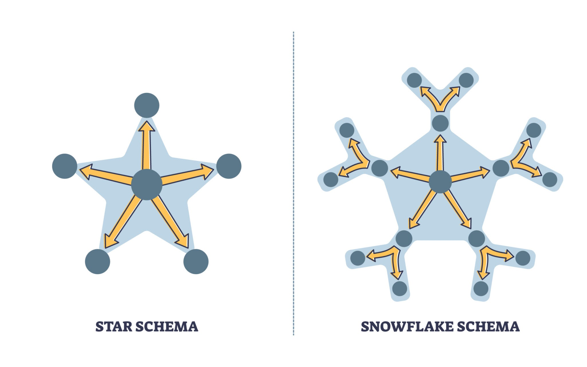

The core difference between a **Star Schema** and a **Snowflake Schema** comes down to **normalization**: a Star Schema keeps dimension tables flat (denormalized) for maximum query speed, while a Snowflake Schema splits dimension tables into sub-tables (normalized) to eliminate data redundancy.

---

| Feature | Star Schema | Snowflake Schema |
| --- | --- | --- |
| **Data Normalization** | **Denormalized** — dimension tables contain redundant data in single wide tables. | **Normalized** (typically 3NF) — dimension tables are split into related sub-tables. |
| **Structure / Topology** | One central **Fact Table** connected directly to single-layer **Dimension Tables** (resembles a star). | Central **Fact Table** connected to **Dimension Tables**, which branch out into **Sub-Dimension Tables** (resembles a snowflake). |
| **Query Performance** | **Faster** — requires fewer `JOIN` operations to retrieve attributes. | **Slower** — requires multiple cascading `JOIN`s across normalized dimension hierarchies. |
| **Query Complexity** | **Simple** — intuitive SQL queries for BI tools and analysts. | **Complex** — deeper join paths make ad-hoc querying harder. |
| **Storage Space** | **Higher** — repeated attribute values (e.g., repeating "Country" or "Category" on every row) consume more disk space. | **Lower** — eliminates duplicate strings and attributes across dimension rows. |
| **ETL / Load Complexity** | **Simpler** — fewer tables to populate and maintain during data ingestion. | **More Complex** — requires maintaining foreign-key hierarchies across multiple sub-tables. |
| **Data Integrity** | Higher risk of update anomalies if a denormalized attribute changes across thousands of rows. | Stronger referential integrity; updating a shared attribute happens in a single sub-table row. |

### Concrete Example: A `Product` Dimension

* **Star Schema:** You have a single `Dim_Product` table containing `Product_ID`, `Product_Name`, `Subcategory_Name`, and `Category_Name`. If you sell 5,000 laptops, the string `"Electronics"` is stored 5,000 times.
* **Snowflake Schema:** `Dim_Product` holds only `Product_ID`, `Product_Name`, and a `Subcategory_ID` foreign key. That links to `Dim_Subcategory`, which links to `Dim_Category`—storing `"Electronics"` only once.

### When to Choose Which

* **Use Star Schema** as your default for modern analytics, OLAP cubes, and BI reporting (Power BI, Tableau, Looker). Storage is cheap, and minimizing `JOIN`s dramatically speeds up read-heavy analytical queries.
* **Use Snowflake Schema** when dimension tables are massive (tens of millions of rows) with heavy attribute repetition, when strict master-data integrity is required, or when specific sub-dimensions are shared at different grains across multiple fact tables.